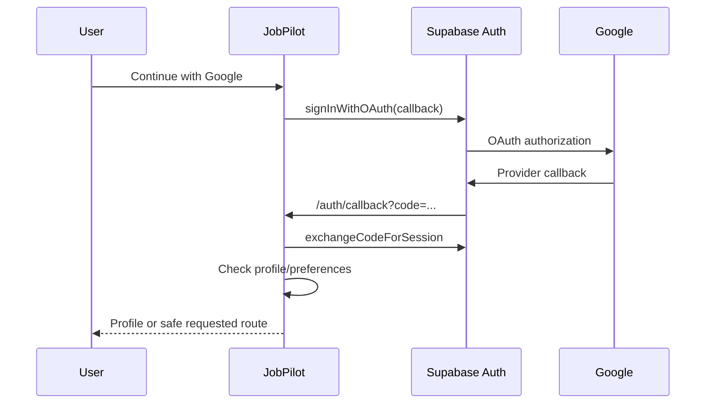

# Authentication flow

Last verified: 2026-11-01

## Entry condition

An unauthenticated visitor chooses Google sign-in at `/auth/login`, or requests a protected page and is redirected there by `proxy.ts` with a safe `next` path.

## Steps

Routes: `/auth/login`, `/auth/callback`, requested protected route. API call: Supabase Auth SDK; no JobPilot JSON API.

Database effects: `handle_new_user` creates `profiles`; callback reads `profiles` and `job_preferences`. Security: canonical callback origin, internal-only `next`, server code exchange, protected-page proxy, and server-side API authentication.

Failure states: provider cancellation, missing/invalid code, missing production site URL, session exchange failure, or profile read failure. Failures return to Login with a stable code; they do not expose provider details.

Exit condition: an authenticated session exists and the user reaches Profile when required fields/preferences are incomplete, otherwise the safe requested route or Dashboard. Current UI supports Google OAuth, email/password sign-in, confirmation and password recovery.

## Production login incident — 1 November 2026

**Scope:** urgent repair of `oauth_callback_failed` on `https://parth-careers.vercel.app`. Vercel and Supabase logs both report `code challenge does not match previously saved code verifier`. The shared fixed PKCE verifier can be replaced by an overlapping OAuth/confirmation/recovery start. Browser callbacks previously carried no flow selector and the server exchanged only `code`.

**Fix:** the installed Supabase SDK's documented `auth.experimental.appendPkceFlowIdToRedirects` option appends `sb_flow_id`; callback forwards that exact selector. The SDK selects only the corresponding cookie slot. A present empty/invalid/unknown ID fails closed without falling back to another flow; an absent ID retains compatibility with existing links. Never remove PKCE, copy another flow's verifier, automatically replay a failed code, expose tokens, or relax account checks/RLS. Shared tabs still share their eventual browser session; the fix isolates pending verifiers, not tab identities. This SDK feature is experimental; keep lockfile/tests when upgrading. Reference: [Supabase PKCE overlapping flows](https://supabase.com/docs/guides/auth/sessions/pkce-flow).

**Production routing check:** one synthetic OAuth start (no user login/email/account creation) and the resulting Supabase auth log retain the canonical callback, `next` and synthetic `sb_flow_id`. Google/email providers report enabled. No Supabase settings, schema, user data or credentials changed.

### Release evidence and gates

Environment: Apple Silicon macOS, Node24.21.0; local production build Next16.4.3; existing Vercel project `prj_Ot6AP8eMEzEMvvyqEybYW5jjVFbG`, team `team_nympTu9S1PETNzC57JNj8QlY`. User explicitly requested urgent production repair. No paid resources or external data upload.

| Gate | Status | Evidence / limits |
|---|---|---|
| RED reproduction | PASS | `node --experimental-strip-types --test lib/auth-callback.test.mjs`: old code fails flow-selector and real-SDK overlapping-flow tests |
| GREEN / regressions | PASS | `node --experimental-strip-types --test`:234tests pass after Next/DOMPurify patch; real SSR SDK/cookie jar, mocked token transport, two overlapping valid flows, invalid/empty/unknown selectors and legacy recovery |
| Lint / types | PASS | `npm run lint`; `tsc --noEmit`; lint repeated after development-only Zod patch |
| Production build | PASS | `NEXT_PUBLIC_SITE_URL=https://parth-careers.vercel.app NODE_OPTIONS=--max-old-space-size=2048 npm run build -- --webpack`; no code/context reductions |
| HTTP smoke | PASS | Local production `/auth/login`200, failed/cancelled callback307 to canonical login, unauthenticated `/dashboard`307; invalid callback issues no session cookie |
| Browser journey | PASS | Isolated Chromium, canonical HTTPS origin mapped to local production server: hydrated Google button, correct project/callback, flow selector and matching verifier cookie before redirect, zero page errors. External authorize request aborted; no Google account signed in |
| Independent security review | PASS | Separate read-only agent reviewed PKCE/redirect/access boundaries and dependency diff; no actionable new finding. Not a penetration-test claim |
| Auth/privacy/accessibility | PASS scoped | Internal redirect sanitizer, trusted exchange and user/account checks remain. Existing login labels/keyboard controls/error alerts unchanged; browser button works. No complete WCAG audit claimed |
| Dependency advisories | PASS critical/high | Existing critical Next and DOMPurify advisories patched; subsequent dev-only Zod high patched within existing range. Full audit:0critical/0high,16moderate development-only notices remain. No affected production packages in final audit |
| Production Google account completion | NOT TESTED | Requires an actual user's fresh sign-in/consent after deployment; no password, Google session or real confirmation/reset email used by tests |
| Load / p95 / p99 | NOT APPLICABLE | Narrow auth incident; two overlapping synthetic flows tested, no stress test or performance claim |
| Data migration / restore | NOT APPLICABLE | No schema/data mutation; no auth/session clearing or credential rotation. Full data restore not exercised |
| Public launch readiness | NOT READY (broader product) | This hotfix does not certify all Careers features, account recovery delivery, browser/device matrix or public launch acceptance |

Initial anonymous HTML-only smoke incorrectly expected client-rendered Google text in a static shell; corrected to validate the loading shell plus actual Chromium hydration. Initial direct localhost browser check exercised the existing localhost callback default; the canonical-origin test preserves the production callback assertion while mapping all app responses to the local build. Neither adjustment bypasses auth checks.

### Security findings and remediation

- **AUTH-01 / high availability impact:** overlapping login verifier mismatch, confirmed in production logs. Owner: Parth Software Labs. Matching flow selection repaired;234regressions and protocol/browser checks pass. Actual owner Google completion remains unverified.
- **DEP-01 / critical:** Next16.3.8 in affected ranges ([SVG image optimizer](https://github.com/advisories/GHSA-2464-fhr4-w9xw), [cached typed arrays](https://github.com/advisories/GHSA-673q-mjm6-r5xr), Server Actions DoS). Remediation: pinned Next/eslint-config-next16.4.3; final audit no critical/high.
- **DEP-02 / critical:** DOMPurify3.4.12 ([template bypass](https://github.com/advisories/GHSA-cg2g-xh64-v4q7) and related notices). Remediation: pinned3.4.17, existing sanitizer configuration retained; build/types pass.
- **DEP-03 / high, dev-only:** Zod collection memory exhaustion via lint tooling. Updated existing transitive dependency within allowed range; lint and full audit retested, no high notices remain.

### Deployment, smoke and rollback

Prior active production deployment: `dpl_Hxf8EVGNoE4F39sxNbHisnYLCnyb` (`parth-careers-8925wz2td-dineshkothari-rds-projects.vercel.app`); project Git link is absent, so use the explicitly scoped Vercel CLI deployment. Verify new deployment READY and canonical alias before declaring it deployed. Run canonical login rendering and Google-initiation cookie smoke after deployment. Rollback: use Vercel's rollback to this recorded deployment if the hotfix breaks service; that previous deployment contains the noted dependency advisories, so rollback is temporary incident recovery, not a security resolution. No schema rollback is needed. Actual traffic rollback/Google-account completion has not been exercised.
